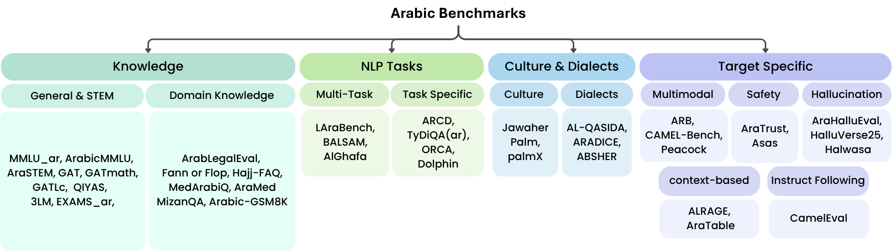

# Arabic LLM Benchmarks

A comprehensive repository of Arabic LLMs benchmarks and evaluation benchmarks, curated from systematic research on evaluating Arabic Large Language Models.

**📚 Survey paper:** [Evaluating Arabic Large Language Models: A Survey of Benchmarks, Methods, and Gaps](https://arxiv.org/abs/2510.13430)

---

## Table of Contents
* [Overview](#overview)
* [Taxonomy](#taxonmoy)
    1. [Knowledge](#STEM_DOM)
        - [General & STEM](#STEM)
        - [Domain Knowledge](#DOM)
    3. [NLP Tasks](#NLP)
    4. [Culture & Dialects](#cult)
    5. [Specific-Targets](#target)
* [Citation](#citations)

---

# <a name='overview'></a> 📋 Overview
This survey provides the first systematic review of Arabic LLM benchmarks, analyzing 40+ evaluation benchmarks across NLP tasks, knowledge domains, cultural understanding, and specialized capabilities. We propose a taxonomy organizing benchmarks into four categories: Knowledge and STEM, NLP Tasks, Culture and Dialects, and Target-Specific evaluations. Our analysis reveals significant progress in benchmark diversity while identifying critical gaps: limited temporal evaluation, insufficient multi-turn dialogue assessment, and cultural misalignment in translated datasets. We examine three primary approaches: native collection, translation, and synthetic generation discussing their trade-offs regarding authenticity, scale, and cost. This work serves as a comprehensive reference for Arabic NLP researchers, providing insights into benchmark methodologies, reproducibility standards, and evaluation metrics while offering recommendations for future development.


---

#  <a name='taxonmoy'></a>🗂️ Taxonomy

The taxonomy formed based on existing work/benchmarks is depicted above. Each of the categories is defined below:
* **Knowledge** includes benchmarks evaluating acquired knowledge and reasoning capabilities, along with domain-specific benchmarks in fields such as law and medicine.
* **Natural Language Processing (NLP)** encompasses early task-specific benchmarks and comprehensive multi-task benchmarks, reflecting the evolution from narrow task evaluation to unified assessment across diverse dialects and domains.
* **Culture and Dialects** groups benchmarks assessing cultural knowledge and dialect understanding, addressing the essential property of cultural awareness in Arabic LLMs.
* **Target-Specific** covers benchmarks designed to assess particular LLM properties such as safety, hallucination detection, instruction-following, and vision capabilities.

---

##  <a name='STEM_DOM'></a>🔬 Knowledge
###  <a name='STEM'></a>⚙️ General Knowledge & STEM
| Name | Paper/Benchmark | Links | Access |
|------|-----------------|-------|--------|
| MMLU | Measuring Massive Multitask Language Understanding| [paper](https://arxiv.org/abs/2009.03300) • [data](https://huggingface.co/datasets/MBZUAI/ArabicMMLU) • [lighteval](https://github.com/huggingface/lighteval/blob/main/community_tasks/arabic_evals.py)| Public |
| EXAMS | EXAMS: A Multi-Subject High School Examinations Dataset for Cross-Lingual and Multilingual Question Answering| [paper](https://arxiv.org/abs/2011.03080) • [data](https://huggingface.co/datasets/OALL/Arabic_EXAMS) • [lighteval](https://github.com/huggingface/lighteval/blob/main/community_tasks/arabic_evals.py)| Public |
| ArabicMMLU | ArabicMMLU: Assessing Massive Multitask Language Understanding in Arabic| [paper](https://arxiv.org/abs/2402.12840) • [data](https://huggingface.co/datasets/MBZUAI/ArabicMMLU) • [repo](https://github.com/mbzuai-nlp/ArabicMMLU)| Public |
| AraSTEM | AraSTEM: A Native Arabic Multiple Choice Question Benchmark for Evaluating LLMs Knowledge In STEM Subjects| [paper](https://arxiv.org/abs/2501.00559)| Private |
| GAT | A bilingual benchmark for evaluating large language models | [paper](https://peerj.com/articles/cs-1893/)| Private |
| Qiyas | The Qiyas Benchmark: Measuring ChatGPT Mathematical and Language Understanding in Arabic | [paper](https://arxiv.org/abs/2407.00146)| Private |
| GATmath & GATLc | GATmath and GATLc: Comprehensive benchmarks for evaluating Arabic large language models| [paper](https://journals.plos.org/plosone/article?id=10.1371/journal.pone.0329129#:~:text=We%20created%20the%20GATmath%2C%20a,benchmark%20dataset%20named%20the%20GATLc.) • [data](https://www.kaggle.com/datasets/c1adf50de06a2d0ecce0141840f602d4de7d838e81224d9a7fc2af4f357e216c) | Public |
| 3LM | 3LM: Bridging Arabic, STEM, and Code through Benchmarking| [paper](https://arxiv.org/abs/2507.15850) • [data](https://huggingface.co/collections/tiiuae/3lm-arabic-benchmark-687de9629072871e702d35e1) • [repo](https://github.com/tiiuae/3LM-benchmark) | Public |

###  <a name='DOM'></a>🏛️ Domain Knowledge
| Name | Paper/Benchmark | Topic | Links | Access |
|------|----------------| -------|-------|--------|
| ArabLegalEval | ArabLegalEval: A Multitask Benchmark for Assessing Arabic Legal Knowledge in Large Language Models| Law | [paper](https://arxiv.org/abs/2408.07983) • [repo](https://github.com/Thiqah/ArabLegalEval)| Public |
| AraMed | AraMed: Arabic Medical Question Answering using Pretrained Transformer Language Models| Medical | [paper](https://aclanthology.org/2024.osact-1.6/) • [repo](https://github.com/Waadtss/AraMed)| Public |
| MizanQA | MizanQA: Benchmarking Large Language Models on Moroccan Legal Question Answering| Law | [paper](https://arxiv.org/abs/2508.16357) • [data](https://huggingface.co/datasets/adlbh/MizanQA-v0)| Public |
| Fann or Flop | Fann or Flop: A Multigenre, Multiera Benchmark for Arabic Poetry Understanding in LLMs| Poetry| [paper](https://arxiv.org/html/2505.18152v1) • [data](https://huggingface.co/datasets/omkarthawakar/FannOrFlop) • [repo](https://github.com/mbzuai-oryx/FannOrFlop)| Public |
| MedArabiQ | MedArabiQ: Benchmarking Large Language Models on Arabic Medical Tasks|Medical|[paper](https://arxiv.org/abs/2505.03427) • [repo](https://github.com/nyuad-cai/MedArabiQ)| Public |
| Arabic-Gsm8k | Arabic-Gsm8k| Reasoning| [data](https://huggingface.co/datasets/Omartificial-Intelligence-Space/Arabic-gsm8k)| Public |
| Hajj-FQA | Hajj-FQA: A benchmark Arabic dataset for developing question-answering systems on Hajj fatwas| Religion | [paper](https://link.springer.com/article/10.1007/s44443-025-00128-w)| Private |

---

##  <a name='NLP'></a>💬 NLP Tasks
| Name | Paper/Benchmark | Links | Access |
|------|-----------------|-------|--------|
| SOQAL | Neural Arabic Question Answering| [paper](https://aclanthology.org/W19-4612/) • [data](https://huggingface.co/datasets/hsseinmz/arcd) • [repo](https://github.com/husseinmozannar/SOQAL)| Public |
| TyDi QA | TyDi QA: A Benchmark for Information-Seeking Question Answering in Typologically Diverse Languages| [paper](https://arxiv.org/abs/2003.05002) • [repo](https://github.com/google-research-datasets/tydiqa)| Public |
| ORCA | ORCA: A Challenging Benchmark for Arabic Language Understanding| [paper](https://aclanthology.org/2023.findings-acl.609/) • [data](https://huggingface.co/datasets/UBC-NLP/orca)| Public |
| Dolphin | Dolphin: A Challenging and Diverse Benchmark for Arabic NLG| [paper](https://arxiv.org/abs/2305.14989)| Private |
| LAraBench | LAraBench: Benchmarking Arabic AI with Large Language Models| [paper](https://aclanthology.org/2024.eacl-long.30.pdf) • [repo](https://github.com/qcri/LLMeBench)| Public |
| BALSAM | BALSAM: A Platform for Benchmarking Arabic Large Language Models| [paper](https://arxiv.org/abs/2507.22603) • [website](https://benchmarks.ksaa.gov.sa/b/balsam)| Public |
| AlGhafa | AlGhafa Evaluation Benchmark for Arabic Language Models | [paper](https://aclanthology.org/2023.arabicnlp-1.21/) • [data](https://huggingface.co/datasets/OALL/AlGhafa-Arabic-LLM-Benchmark-Native) • [repo](https://gitlab.com/tiiuae/alghafa) | Public |

---

##  <a name='cult'></a> 🌍 Culture & Dialects
| Name | Paper/Benchmark | Links | Access |
|------|-----------------|-------|--------|
| Jawaher | Jawaher: A Multidialectal Dataset of Arabic Proverbs for LLM Benchmarking | [paper](https://arxiv.org/abs/2503.00231) • [data](https://huggingface.co/datasets/UBC-NLP/Jawaher-benchmark)| Public |
| Palm | Palm: A Culturally Inclusive and Linguistically Diverse Dataset for Arabic LLMs| [paper](https://arxiv.org/abs/2503.00151v1) • [data](https://huggingface.co/datasets/UBC-NLP/palm) • [repo](https://github.com/UBC-NLP/palm)| Public |
| PalmX | PalmX 2025: The First Shared Task on Benchmarking LLMs on Arabic and Islamic Culture| [paper](https://arxiv.org/abs/2509.02550) • [data](https://huggingface.co/datasets/UBC-NLP/palmx_2025_subtask1_culture) • [data](https://huggingface.co/datasets/UBC-NLP/palmx_2025_subtask2_islamic) • [website](https://palmx.dlnlp.ai/)| Public |
| ArabCulture | Commonsense Reasoning in Arab Culture| [paper](https://arxiv.org/abs/2502.12788) • [data](https://huggingface.co/datasets/MBZUAI/ArabCulture) • [lm-eval](https://github.com/EleutherAI/lm-evaluation-harness/tree/main/lm_eval/tasks/arab_culture)| Public |
| AraDiCE | AraDiCE: Benchmarks for Dialectal and Cultural Capabilities in LLMs| [paper](https://arxiv.org/abs/2409.11404) • [data](https://huggingface.co/datasets/QCRI/AraDiCE) • [lm-eval](https://github.com/EleutherAI/lm-evaluation-harness/tree/main/lm_eval/tasks/aradice)| Public |
| AL-QASIDA | AL-QASIDA: Analyzing LLM Quality and Accuracy Systematically in Dialectal Arabic| [paper](https://arxiv.org/abs/2412.04193)| Private |
| Absher | Absher: A Benchmark for Evaluating Large Language Models Understanding of Saudi Dialects| [paper](https://arxiv.org/abs/2507.10216)| Private |

---

##  <a name='target'></a> 🎯 Specific-Targets
| Name | Paper/Benchmark | Topic | Links | Access |
|------|----------------| -------|-------|--------|
| CamelEval | CamelEval: Advancing Culturally Aligned Arabic Language Models and Benchmarks | Instruction-following | [paper](https://arxiv.org/abs/2409.12623)| Private |
| Halwasa | Halwasa: Quantify and Analyze Hallucinations in Large Language Models: Arabic as a Case Study| Hallucination | [paper](https://aclanthology.org/2024.lrec-main.705/)| Private |
| Peacock | Peacock: A Family of Arabic Multimodal Large Language Models and Benchmarks| Multimodal| [paper](https://arxiv.org/abs/2403.01031) • [data](https://huggingface.co/datasets/UBC-NLP/Henna-Bench-Eval) • [repo](https://github.com/UBC-NLP/peacock)| Public |
| CAMEL-Bench | CAMEL-Bench: A Comprehensive Arabic LMM Benchmark| Multimodal| [paper](https://arxiv.org/abs/2410.18976) • [data](https://huggingface.co/collections/ahmedheakl/camel-bench-670750f3998395452cd3b7b1) • [repo](https://mbzuai-oryx.github.io/Camel-Bench/)| Public |
| AraTrust | AraTrust: An Evaluation of Trustworthiness for LLMs in Arabic| Safety| [paper](https://arxiv.org/abs/2410.17040) • [data](https://huggingface.co/datasets/asas-ai/AraTrust)| Public |
| Arabic Safety Dataset | Arabic Dataset for LLM Safeguard Evaluation| Safety| [paper](https://arxiv.org/html/2505.18152v1) • [repo](https://github.com/mbzuai-nlp/Arabic_safety_evaluation)| Public |
| ALRAGE | ALRAGE | Context-Based (RAG)| [data](https://huggingface.co/datasets/OALL/ALRAGE)| Public |
| AraTable | AraTable: Benchmarking LLMs' Reasoning and Understanding of Arabic Tabular Data | Context-Based (Tabular)| [paper](https://arxiv.org/abs/2507.18442) • [repo](https://github.com/rana-alshaikh/AraTable-Benchmark)| Public |
| AraHalluEval | AraHalluEval: A Fine-grained Hallucination Evaluation Framework for Arabic LLMs| Hallucination| [paper](https://www.arxiv.org/abs/2509.04656) • [repo](https://github.com/aishaalansari57/AraHalluEval)| Public |
| HalluVerse25 | HalluVerse25: Fine-grained Multilingual Benchmark Dataset for LLM Hallucinations| Poetry| [paper](https://arxiv.org/abs/2503.07833)| Private |
| ARB | ARB: A Comprehensive Arabic Multimodal Reasoning Benchmark | Multimodal| [paper](https://arxiv.org/abs/2505.17021) • [data](https://huggingface.co/datasets/MBZUAI/ARB) • [repo](https://github.com/mbzuai-oryx/ARB)| Public |
| ASAS | Redteaming Frontier LLMs with AI Astrolabe Arabic Safety Index (ASAS - أساس)| Safety| [blog](https://www.aiastrolabe.com/post/redteaming-frontier-llms-with-ai-astrolabe-arabic-safety-index-asas)| Public |

---

# 🤝 Contributing

We welcome contributions! If you'd like to add new benchmarks or improve existing information, please feel free to submit issues or pull requests.

---

#  <a name='citations'></a>📖 Citation
If you use this repository or find the survey helpful, please cite:
```bibtex
@misc{alzubaidi2025evaluatingarabiclargelanguage,
      title={Evaluating Arabic Large Language Models: A Survey of Benchmarks, Methods, and Gaps}, 
      author={Ahmed Alzubaidi and Shaikha Alsuwaidi and Basma El Amel Boussaha and Leen AlQadi and Omar Alkaabi and Mohammed Alyafeai and Hamza Alobeidli and Hakim Hacid},
      year={2025},
      eprint={2510.13430},
      archivePrefix={arXiv},
      primaryClass={cs.CL},
      url={https://arxiv.org/abs/2510.13430}, 
}
```
