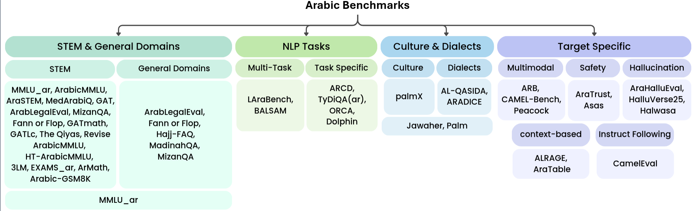

# Arabic-LLM-Benchmarks
This repo provides a list of existing Arabic benchmarks and evaluation efforts that were reported in this [work](https://arxiv.org/abs/2507.15850)

## Table of Contents
* [Abstract](#abstract)
* [citation](#citations)
* [Taxonomy](#taxonmoy)
    1. [STEM & Domain Knowledge](#STEM_DOM)
        - [STEM](#STEM)
        - [Domain Knowledge](#DOM)
    3. [NLP Tasks](#NLP)
    4. [Culture & Dialects](#cult)
    5. [Specific-Targets](#target)


# <a name='abstract'></a> Abstract
This survey provides the first systematic review of Arabic LLM benchmarks, analyzing 40 evaluation frameworks across NLP tasks, knowledge domains, cultural understanding, and specialized capabilities. We propose a taxonomy organizing benchmarks into four categories: Knowledge and STEM, NLP Tasks, Culture and Dialects, and Target-Specific evaluations. Our analysis reveals significant progress in benchmark diversity while identifying critical gaps: limited temporal evaluation, insufficient multi-turn dialogue assessment, and cultural misalignment in translated datasets. We examine three primary approaches: native collection, translation, and synthetic generation discussing their trade-offs regarding authenticity, scale, and cost. This work serves as a comprehensive reference for Arabic NLP researchers, providing insights into benchmark methodologies, reproducibility standards, and evaluation metrics while offering recommendations for future development.

#  <a name='citations'></a>Citation

```
@misc{alarabic bench,
      title={Evaluating Arabic Large Language Models: A Survey of Benchmarks, Methods, and Gaps}, 
      author={author names},
      year={2025},
      eprint={2501.02189},
      archivePrefix={arXiv},
      primaryClass={cs.CV},
      url={https://arxiv.org/abs/2501.02189}, 
}
```

#  <a name='taxonmoy'></a>Taxonmoy

The taxonomy formed based on existing work/benchmarks is depicted above. Each of the categories is defined below:
* **Knowledge and STEM** includes benchmarks evaluating acquired knowledge and reasoning capabilities, along with domain-specific benchmarks in fields such as law and medicine.
* **Natural Language Processing (NLP)** encompasses early task-specific benchmarks and comprehensive multi-task benchmarks, reflecting the evolution from narrow task evaluation to unified assessment across diverse dialects and domains.
* **Culture and Dialects** groups benchmarks assessing cultural knowledge and dialect understanding, addressing the essential property of cultural awareness in Arabic LLMs.
* **Target-Specific** covers benchmarks designed to assess particular LLM properties such as safety, hallucination detection, instruction-following, and vision capabilities.
##  <a name='STEM_DOM'></a>STEM & Domain Knowledge
###  <a name='STEM'></a>STEM
| Paper/Benchmark | Links  |
|----------------|---------|
|Measuring Massive Multitask Language Understanding| [[paper](https://arxiv.org/abs/2009.03300)] [[data](https://huggingface.co/datasets/MBZUAI/ArabicMMLU)] [[lighteval](https://github.com/huggingface/lighteval/blob/main/community_tasks/arabic_evals.py)]|
|EXAMS: A Multi-Subject High School Examinations Dataset for Cross-Lingual and Multilingual Question Answering| [[paper](https://arxiv.org/abs/2011.03080)] [[data](https://huggingface.co/datasets/OALL/Arabic_EXAMS)] [[lighteval](https://github.com/huggingface/lighteval/blob/main/community_tasks/arabic_evals.py)]|
|ArabicMMLU: Assessing Massive Multitask Language Understanding in Arabic| [[paper](https://arxiv.org/abs/2402.12840)] [[data](https://huggingface.co/datasets/MBZUAI/ArabicMMLU)] [[repo](https://github.com/mbzuai-nlp/ArabicMMLU)]|
|AraSTEM: A Native Arabic Multiple Choice Question Benchmark for Evaluating LLMs Knowledge In STEM Subjects| [[paper](https://arxiv.org/abs/2501.00559)]|
|A bilingual benchmark for evaluating large language models | [[paper](https://peerj.com/articles/cs-1893/)]|
|The Qiyas Benchmark: Measuring ChatGPT Mathematical and Language Understanding in Arabic | [[paper](https://arxiv.org/abs/2407.00146)]|
|GATmath and GATLc: Comprehensive benchmarks for evaluating Arabic large language models| [[paper](https://journals.plos.org/plosone/article?id=10.1371/journal.pone.0329129#:~:text=We%20created%20the%20GATmath%2C%20a,benchmark%20dataset%20named%20the%20GATLc.)] [[data](https://www.kaggle.com/datasets/c1adf50de06a2d0ecce0141840f602d4de7d838e81224d9a7fc2af4f357e216c)] |
|3LM: Bridging Arabic, STEM, and Code through Benchmarking| [[paper](https://arxiv.org/abs/2507.15850)] [[data](https://huggingface.co/collections/tiiuae/3lm-arabic-benchmark-687de9629072871e702d35e1)] [[repo](https://github.com/tiiuae/3LM-benchmark)] |
###  <a name='DOM'></a>Domain Knowledge
| Paper/Benchmark | Topic | Links   |
|----------------| -------|---------|
|ArabLegalEval: A Multitask Benchmark for Assessing Arabic Legal Knowledge in Large Language Models| Law | [[paper](https://arxiv.org/abs/2408.07983)] [[repo](https://github.com/Thiqah/ArabLegalEval)]|
|AraMed: Arabic Medical Question Answering using Pretrained Transformer Language Models| Medical | [[paper](https://aclanthology.org/2024.osact-1.6/)] [[repo](https://github.com/Waadtss/AraMed)] | 
|MizanQA: Benchmarking Large Language Models on Moroccan Legal Question Answering| Law | [[paper](https://arxiv.org/abs/2508.16357)] [[data](https://huggingface.co/datasets/adlbh/MizanQA-v0)]|
|Fann or Flop: A Multigenre, Multiera Benchmark for Arabic Poetry Understanding in LLMs| Poetry| [[paper](https://arxiv.org/html/2505.18152v1)] [[data](https://huggingface.co/datasets/omkarthawakar/FannOrFlop)] [[repo](https://github.com/mbzuai-oryx/FannOrFlop)]|
|MedArabiQ: Benchmarking Large Language Models on Arabic Medical Tasks|Medical|[[paper](https://arxiv.org/abs/2505.03427)] [[repo](https://github.com/nyuad-cai/MedArabiQ)]|
|Arabic-Gsm8k| Reasoning| [[data](https://huggingface.co/datasets/Omartificial-Intelligence-Space/Arabic-gsm8k)]|
|Hajj-FQA: A benchmark Arabic dataset for developing question-answering systems on Hajj fatwas| Religion | [[paper](https://link.springer.com/article/10.1007/s44443-025-00128-w)]
##  <a name='NLP'></a>NLP Tasks
| Paper/Benchmark | Links   |
|-----------------|---------|
|Neural Arabic Question Answering| [[paper](https://aclanthology.org/W19-4612/)] [[data](https://huggingface.co/datasets/hsseinmz/arcd)] [[repo](https://github.com/husseinmozannar/SOQAL)] |     
|TyDi QA: A Benchmark for Information-Seeking Question Answering in Typologically Diverse Languages| [[paper](https://arxiv.org/abs/2003.05002))] [[repo](https://github.com/google-research-datasets/tydiqa)] |
|ORCA: A Challenging Benchmark for Arabic Language Understanding| [[paper](https://aclanthology.org/2023.findings-acl.609/)] [[data](https://huggingface.co/datasets/UBC-NLP/orca)] |
|Dolphin: A Challenging and Diverse Benchmark for Arabic NLG| [[paper](https://arxiv.org/abs/2305.14989)] |
|LAraBench: Benchmarking Arabic AI with Large Language Models| [[paper](https://aclanthology.org/2024.eacl-long.30.pdf)]  [[repo](https://github.com/qcri/LLMeBench)] |
|BALSAM: A Platform for Benchmarking Arabic Large Language Models| [[paper](https://arxiv.org/abs/2507.22603)]  [[website](https://benchmarks.ksaa.gov.sa/b/balsam)] |
##  <a name='cult'></a> Culture & Dialects
##  <a name='target'></a> Specific-Targets
